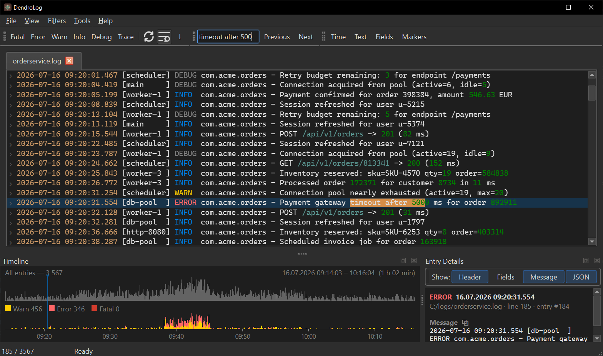

<p align="center">
  
</p>

<h1 align="center">DendroLog</h1>

<p align="center">
  <b>A fast desktop viewer for log files</b> — multi-file tabs, structured field
  extraction, filtering, highlighting and live reload. For Windows and Linux.
</p>

<p align="center">
  <a href="https://github.com/scaremongr/dendrolog/actions/workflows/ci.yml"></a>
  <a href="https://github.com/scaremongr/dendrolog/releases/latest"></a>
  <a href="LICENSE"></a>
</p>

<p align="center">
  
</p>

## Features

- **Multi-file tabs** — open several files into one tab, merged by timestamp.
  ISO, syslog, nginx / Apache access and nginx error timestamps are read with
  their time zone; a line that opens with a timestamp starts a new entry, so
  plain logs split into entries without any setup.
- **Huge files** — multi-gigabyte logs open without being loaded into RAM: a
  compact line index (~10 bytes per line) keeps scrolling, filtering and
  search responsive while the text stays on disk.
- **Directory scanner** — scan a whole folder of logs into a sortable tree:
  per-file entry counts, time ranges, warn/error/fatal counts and sizes;
  narrow it down by content or date range and open files right from the results.
  Rotated logs (`app.log.1`, `app.log-20260101`) are listed; drop a folder on
  the window to scan it.
- **Field schemas** — split entries into structured fields (timestamp, level,
  thread, message…); ready-made schemas for Logback / Log4j, Spring Boot,
  nginx / Apache, syslog / journalctl, Serilog and Python logging, auto-detect
  from a sample line or import a **Grok** expression.
- **Filtering** — log level, time range, and an Include/Exclude rule builder
  with AND/OR, regex, per-field binding. Select text in the log and right-click
  to show only, hide, highlight or find lines with it.
- **Quick find** — whole word, regular expression and recent searches right
  in the toolbar box; **All** lists every match in the Search panel.
- **Go to line or time** — `Ctrl+G` jumps to a line number of the file or to a
  moment; with filters on it lands on the nearest shown line.
- **Next / previous error** — `F8` / `Shift+F8` step through Error and Fatal
  lines, `F7` / `Shift+F7` through warnings, without freezing the window on a huge log.
- **Bookmarks with notes** — `Ctrl+F2` marks a line, `F2` / `Shift+F2` jump
  between bookmarks, the Bookmarks panel lists them with a note each; they stay
  through filters, reloads and the switch to the large-file mode.
- **File memory** — a file opened again gets back its bookmarks, row
  highlighters and position, and its last filters with one click; a rotated or
  moved file finds its memory by its content.
- **Sessions** — save all tabs with their filters, bookmarks and positions to a
  `.dlsession` file and open it later, elsewhere or on a colleague's machine:
  logs moved together with the session are found by a relative path, missing
  or changed files are listed in a restore report. The previous session's tabs
  come back at startup (an option) or with one link on the start screen, and
  `Ctrl+Shift+T` reopens a closed tab.
- **Navigation history** — `Alt+←` / `Alt+→` go back to where a jump (search,
  Statistics, timeline, bookmark, Go to, `F8`) started and forward again.
- **Marks on the scrollbar** — errors, warnings, bookmarks and Search panel
  matches are visible on the scrollbar at a glance; computed in the background,
  even on a log of tens of millions of lines.
- **Row highlighters** — colour matching rows without hiding anything.
- **Timeline histogram** — entry density over time; click to jump, drag to filter.
- **Statistics panel** — level counts, top repeated messages, rate, anomalies.
- **Live reload** — re-read appended lines manually (`F5`) or automatically;
  reading further up, a `↓ N new lines` badge counts what arrived below.
- **Encodings** — UTF-8, Windows-1251, IBM866, KOI8-R and Windows-1252 are
  detected per file; the status bar shows the encoding and changes it with a
  click (no re-indexing, you keep your place); `--encoding` on the command line.
- **Smart text handling** — syntax highlighting, token-aware double-click
  selection, open URLs/paths from the log, per-line word wrap.
- **Save View As** — export exactly what you see (filters + field selection).
- Light/dark theme: follows the OS or is picked by hand; fully configurable
  shortcuts, EN/RU help.

## Install

**Windows**
- Installer: grab `DendroLog-<version>-setup.exe` from the
  [latest release](https://github.com/scaremongr/dendrolog/releases/latest).
- Portable: unzip `DendroLog-<version>-win64-portable.zip` anywhere and run
  `DendroLog.exe` — settings stay next to the exe.

**Linux**
- Download `DendroLog-<version>-x86_64.AppImage`, `chmod +x`, run.

**macOS** — not packaged yet; builds from source with Qt 6.5+.

## Build from source

Requires CMake 3.16+ and Qt 6.5+ (Widgets, Concurrent, Svg, Network).

```sh
cmake -S . -B build -DCMAKE_BUILD_TYPE=Release
cmake --build build --config Release
ctest --test-dir build -C Release   # smoke tests
```

On Windows, run `windeployqt` on the built `DendroLog.exe` to collect Qt DLLs.

## Portable mode

DendroLog stores settings in the user profile
(`%LOCALAPPDATA%/DendroLog` on Windows, `~/.config/DendroLog` on Linux).
If a file named `portable` (or an existing `DendroLog.ini`) sits next to the
executable, settings are kept there instead.
The file memory (bookmarks, markers, position and filters of each opened log)
lives in the `memory` subfolder of the same folder, so it travels with a
portable copy; it can be turned off or cleared in Settings.

## Feedback

Bug reports and feature requests are welcome —
[open an issue](https://github.com/scaremongr/dendrolog/issues).
If DendroLog is useful to you, a ⭐ helps others find it.

## License

[MIT](LICENSE) © Anton Petrov. Built with [Qt](https://www.qt.io) (LGPLv3,
dynamically linked).
